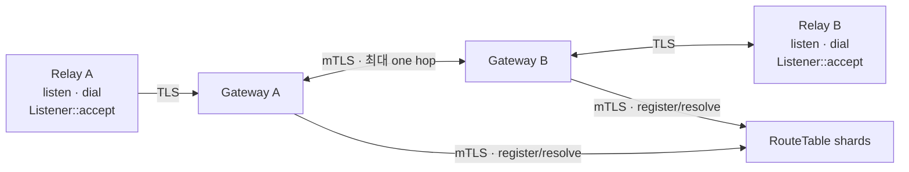

# RelayGate

NAT 뒤 애플리케이션이 outbound session 하나로 Destination을 수신하고 다른 Destination으로 양방향 byte stream을
여는 Rust relay입니다.



```text
Destination -> live Binding 0..N
dial 1회     -> Binding 1개 -> opaque bidirectional Pipe 1개
```

## 책임

| RelayGate | Application |
| --- | --- |
| TLS session과 PUBLISH/DIAL JWT grant 검증 | Destination·token 발급 정책 |
| live Binding 조회와 local/one-hop Pipe | Pipe 상대 인증·인가 |
| bounded queue, timeout, heartbeat, cleanup | payload framing·의미·acknowledgement·retry |
| SDK reconnect와 Listener republish | 필요한 E2E payload 보호 |

RouteTable은 memory-only current state를 유지합니다. 새 연결은 새 `dial`로 시작하며 기존 Pipe와 payload의
수명은 해당 Pipe와 application이 소유합니다.

## Rust SDK

아래 `tokens`는 application이 자신의 async callback을 `AccessTokenSource::dynamic_with_errors`로 감싸 전달합니다.
Callback은 요청의 action·Destination에 맞는 JWT를 공급하며, 발급·갱신·cache는 application/backend가 소유합니다.

```rust,no_run
use relaygate_sdk::{AccessTokenSource, Config, Destination, Relay, ResourceLimits};
use tokio::io::{AsyncWriteExt, copy};

async fn serve_one(tokens: AccessTokenSource) -> Result<(), Box<dyn std::error::Error>> {
    let limits = ResourceLimits::default()
        .with_max_live_pipes_per_listener(1_000)
        .with_max_live_pipes_per_relay(2_000);
    let config = Config::new(std::env::var("RELAYGATE_ADDR")?)?.with_resource_limits(limits);
    let relay = Relay::connect(config).await?;
    let destination: Destination = "inference/stt.seoul".parse()?;
    let listener = relay.listen(destination, tokens).await?;

    // 다른 Relay가 dial한 Pipe 하나를 echo한다.
    let (mut reader, mut writer) = listener.accept().await?.into_split();
    copy(&mut reader, &mut writer).await?;
    writer.shutdown().await?;
    listener.close().await?;
    relay.close();
    Ok(())
}
```

| 경계 | 의미 |
| --- | --- |
| `connect` / `wait_ready` | 현재 transport session 준비; Listener 등록 완료와 별개 |
| Listener `Active` | 현재 Binding 준비; 상태 snapshot은 이후 바뀔 수 있음 |
| `flush` / write shutdown | local transport 전송 완료; 상대 application ACK는 별도 |
| 종료 | 신규 accept 중단 → 진행 중 Pipe 작업을 제한 시간 안에 완료 → `Relay::close` |

[실행 가능한 managed Listener 예제](crates/relaygate-sdk/examples/managed_listener.rs)는 token 파일 재읽기,
상태 관측, Ctrl-C와 제한 시간 내 종료를 보여줍니다. Application/backend가 token 파일을 원자적으로 교체합니다.

```sh
RELAYGATE_ADDR=relaygate.example.com:443 \
RELAYGATE_DESTINATION=examples/echo \
RELAYGATE_PUBLISH_TOKEN_FILE=/run/secrets/publish.jwt \
cargo run -p relaygate-sdk --example managed_listener
```

사설 CA는 예제의 `RELAYGATE_CA_FILE` 또는 SDK의 `Config::with_ca_certificate(pem)`으로 지정합니다.
공인 인증서는 endpoint 이름과 기본 CA 목록으로 검증합니다. `tcp://host:port`는 명시적 평문이고 TLS 실패 시
평문으로 전환하지 않습니다. Session loss 뒤 SDK는 재연결·Listener republish를 수행하지만 기존 Pipe를 복구하지 않습니다.

고급 transport는 `Config::with_transport(transport)`를 사용합니다. CA·검증 이름·client 인증은 `ClientTlsConfig`에서
설정하며 `with_ca_certificate`로 덮어쓰지 않습니다. 상세 동작은 [SDK README](crates/relaygate-sdk/README.md)를 따릅니다.

## Token 발급 helper

Backend는 호출자를 인증하고 operation을 허가한 뒤 server-side helper로 JWT를 생성합니다.

```rust,no_run
use std::time::Duration;

use relaygate_destination::Destination;
use relaygate_token_issuer::{Action, TokenIssuer};

# fn example() -> Result<(), Box<dyn std::error::Error>> {
let private_key = std::fs::read("/run/secrets/relaygate-issuer.pem")?;
let issuer = TokenIssuer::from_es256_pem(
    "https://issuer.example",
    "relaygate",
    "issuer-key-v1",
    private_key,
)?;
let destination: Destination = "inference/stt.seoul".parse()?;

// Application authorization must succeed before this call.
let token = issuer.issue_exact(Action::Dial, &destination, Duration::from_secs(300))?;
# let _ = token;
# Ok(())
# }
```

Helper는 unencrypted P-256 PKCS#8 PEM을 읽고 canonical header·claim을 생성합니다. 로그인, permission 정책,
HTTP endpoint, key 보관·회전과 token cache는 application backend가 소유합니다.

## 검증

| 범위 | 명령 |
| --- | --- |
| Rust compile/test | `cargo fmt --all --check && cargo check --workspace && cargo test --workspace` |
| Rust lint | `cargo clippy --workspace --all-targets --all-features -- -D warnings` |
| RT2/GW3 Compose | `docker compose up --build --abort-on-container-exit --exit-code-from topology-probe` |
| observability | `docker compose --profile observability up --build --abort-on-container-exit --exit-code-from observability-probe observability-probe` |
| 연결 후 DATA RTT | topology 실행 중 `docker compose run --rm --no-deps topology-probe relaygate-echo-probe latency` |
| isolated Kubernetes | `tests/kind/run.sh` |

Compose 종료:

```bash
docker compose --profile observability down --volumes --remove-orphans
```

## 의존성 업데이트

[Dependabot](.github/dependabot.yml)은 매주 Cargo·GitHub Actions·Docker 버전을 확인해 PR을 제안합니다.
취약점 알림과 보안 업데이트는 GitHub Dependabot 설정을 사용합니다. 업데이트 PR은 기존 CI를 통과한 뒤 수동으로 머지합니다.

## crates.io 릴리즈 재실행

[Release crates](.github/workflows/release-crates.yml)는 일부 crate 배포 뒤 실패해도 같은 버전으로 재실행할 수 있습니다.
이미 배포된 package가 현재 소스와 일치하는지 확인하고, 일치하지 않거나 yanked 상태면 새 배포 전에 실패합니다.
배포 없는 사전 검사는 깨끗한 checkout에서 `python3 .github/scripts/release_crates.py`로 실행합니다.

## CI/CD 보안

[공통 보안 기준](docs/security/ci-policy.md)에 PR 의존성 검사, 이미지 릴리스 gate,
일일 재검사와 근거 문서를 정리합니다. 두 아키텍처의 취약점·secret 검사와 Rust 의존성
inventory 확인을 통과한 digest만 릴리스 tag로 승격합니다. 실행 보고서는 30일 보관합니다.

## Helm

차트는 RouteTable과 Gateway를 배포합니다. 기본값은 edge TLS·내부 mTLS이며 인증서는 기존 Secret을 사용합니다.
운영 이미지는 Distroless `cc-debian13` 기반이며 UID/GID `10001:10001`로 실행합니다.
이미지에 shell이 없으므로 점검은 `relaygate-server check`를 직접 실행합니다.

```bash
helm lint deploy/helm/relaygate
helm template relaygate deploy/helm/relaygate --kube-version 1.32.0
```

설치와 rotation 절차는 [Helm chart README](deploy/helm/relaygate/README.md)를 따릅니다.

## 구조

```text
crates/
├── relaygate-destination/           Destination grammar
├── relaygate-protocol/              SDK-GW wire
├── relaygate-transport/             TLS/mTLS adapter
├── relaygate-sdk/                   public Relay, Listener, Pipe API
├── relaygate-token-issuer/          server-side operation JWT helper
├── relaygate-gateway/               Binding, dial, relay, cleanup
├── relaygate-gateway-peer/          GW-GW one-hop transport, handshake, peer wire
├── relaygate-gateway-routing/       RT registration, KeepAlive, Resolve orchestration
├── relaygate-route-table/           memory-only current-state shard
├── relaygate-route-table-transport/ GW-RT bounded transport/auth
└── relaygate-server/                config, wiring, metrics, shutdown
```

[문서 지도](docs/)에서 ADR, SPEC, TEST와 RFC 근거를 확인할 수 있습니다.
