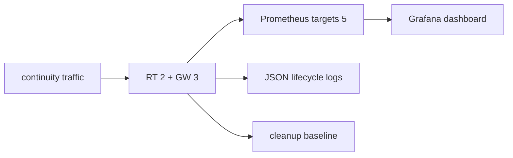

# TEST 006: 관측 검증



Compose observability profile은 `observability-probe`를 완료형 probe로 사용합니다.

## 화면 검증

| 화면 | 기본 표시 | 검증 |
| --- | --- | --- |
| `relaygate-overview` | 숫자 4 + 추이 4, 필터 3개 | 집계값·분류·자원별 최대 점유율 |
| `relaygate-runtime` | 수집 카드 2 + 접힌 영역 3 | 펼친 영역의 중첩 패널까지 PromQL 검사 |
| `relaygate-sdk` | 수집 전제 + 추이 4 | 미수집을 정상 0과 구분 |

CI의 `grafana_ui.cjs`는 실제 Grafana에서 세 화면 provisioning, 시간·필터 유지 링크와 row 펼침을 검증한다.
`relaygate-grafana` artifact는 밝은/어두운 개요, 좁은 화면, 펼치기 전후 진단, SDK 미수집 화면을 보관한다.
스크린샷은 시각 리뷰 증거이며 픽셀 차이 자동 합격 판정은 아니다. 런타임 계측의 동작 계약은 Rust/PromQL 검증이 담당한다.

| 범주 | 증거 |
| --- | --- |
| RED | GW DIAL 결과 class, operation authorization, SDK 접속·dial, publish, RT request/actor result와 duration |
| liveness | SDK/peer heartbeat RTT와 timeout |
| admission | non-draining + session capacity readiness |
| USE | session slot·Binding·pending open·GW Pipe의 used/limit, 고유 Pipe, peer stream, RT BindingProjection gauge |
| recovery | 진행 중 SDK reconnect, recovered/closed/aborted 종료 시간, dependency transition, lease expiry, drain |
| cleanup | topology 종료 뒤 current gauge baseline |
| cardinality | bounded label set |
| redaction | AccessToken·decoded claim·private key·payload marker 0건 |
| logging | component/event/outcome/code lifecycle event |

SDK reconnect 테스트는 process-global tracing callsite 등록을 공유하므로 같은 helper를 호출하는
두 테스트를 test-only lock으로 격리합니다. CI는 SDK lib 전체를 8개 test thread로 20회 반복하고
각 실행에서 recovered/closed 로그와 중첩 reconnect gauge assertion을 유지합니다.

## Pipe latency probe

| 구간 | 측정 |
| --- | --- |
| 준비 | session 연결, 등록 수렴 preflight, idle·active Pipe 생성, Pipe별 warm-up |
| DATA | 같은 Relay의 active Pipe들이 동시에 write/read; 경로는 3 local + 6 directed one-hop 순차 실행 |
| idle Pipe | active Pipe보다 먼저 열고 측정 종료까지 read 감시; EOF·오류·예상하지 않은 DATA는 실패 |
| 결과 | 합쳐진 sample의 p50/p95/p99/max RTT, Pipe별·전체 완료 수, 오류 수, 왕복 payload bytes·echo goodput |
| 시간 | `session_connect_seconds`, 전체 idle·active 준비의 `dial_seconds`, 동시 DATA 구간의 `measurement_seconds` 분리 |

```sh
# 실행 중인 Compose topology, 기존 기본 workload
set -o pipefail
docker compose run --rm --no-deps topology-probe relaygate-echo-probe latency | tee latency.log
python3 .github/scripts/test_observability.py --probe latency.log

# CI의 작은 동시성 profile
docker compose run --rm --no-deps \
  -e RELAYGATE_LATENCY_PAYLOAD_BYTES=4096 \
  -e RELAYGATE_LATENCY_CONCURRENCY=4 \
  -e RELAYGATE_LATENCY_IDLE_PIPES=4 \
  -e RELAYGATE_LATENCY_WARMUP=5 \
  -e RELAYGATE_LATENCY_SAMPLES=25 \
  topology-probe relaygate-echo-probe latency | tee latency-concurrency.log
python3 .github/scripts/test_observability.py --probe latency-concurrency.log \
  --probe-concurrency 4 --probe-idle-pipes 4
```

| 환경변수 | 기본값 | 범위·단위 |
| --- | --- | --- |
| `RELAYGATE_LATENCY_WARMUP` | 100 | Pipe당 0..10000회 |
| `RELAYGATE_LATENCY_SAMPLES` | 1000 | Pipe당 1..100000회; concurrency와 곱 ≤ 100000 |
| `RELAYGATE_LATENCY_PAYLOAD_BYTES` | 64 | 1..65536 bytes |
| `RELAYGATE_LATENCY_CONCURRENCY` | 1 | Relay당 active Pipe 1..64개 |
| `RELAYGATE_LATENCY_IDLE_PIPES` | 0 | Relay당 idle Pipe 0..1024개 |

| profile | payload bytes | active | idle | warm-up / Pipe당 sample |
| --- | --- | --- | --- | --- |
| CI 기본 | 64 | 1 | 0 | 100 / 1000 |
| CI 동시성 | 4096 | 4 | 4 | 5 / 25 |
| 큰 payload | 65536 | 1 | 0 | 100 / 1000 |
| 동시 Pipe | 4096 | 16 | 0 | 100 / 1000 |
| idle Pipe 영향 | 64 | 1 | 256 | 100 / 1000 |

수동 비교는 같은 실행 환경에서 위 값들을 바꿔 실행하고 revision·workload와 결과를 함께 보관한다. 상한은
입력 허용 범위이며 Gateway admission과 실제 수용량을 보장하지 않는다. 큰 profile은 기본 CI에 넣지 않는다.

```sh
# 단일 Destination 수동 실행: 해당 환경의 operation JWT와 TLS CA/server name을 함께 설정한다.
RELAYGATE_ADDR=relaygate.example:443 \
RELAYGATE_DESTINATION=inference/stt.seoul \
RELAYGATE_ACCESS_TOKEN='<signed-jwt>' \
RELAYGATE_LATENCY_PAYLOAD_BYTES=4096 \
RELAYGATE_LATENCY_CONCURRENCY=16 \
RELAYGATE_LATENCY_IDLE_PIPES=0 \
cargo run --release -p relaygate-echo-probe -- latency
```

| JSON 필드 | 집계 기준 |
| --- | --- |
| root `concurrency`, `idle_pipes` | profile의 active·idle Pipe 수 |
| case `samples_per_pipe`, `warmup`, `idle_pipes` | Pipe당 측정·warm-up 횟수와 idle 수 |
| `requested_samples` | `samples_per_pipe × concurrency` |
| `completed_samples_per_pipe` | active Pipe별 완료 수; 배열 길이는 concurrency |
| `completed_samples` | Pipe별 완료 수의 합 |
| `echo_payload_bytes` | `completed_samples × payload_bytes × 2` |
| `echo_goodput_bytes_per_second` | 왕복 payload bytes / 공통 DATA wall time; worker 시간의 합으로 나누지 않음 |

Validator는 9개 경로·설정값·Pipe별 완료 수·byte 집계·유한한 양수 RTT/goodput을 검사한다. 기본 기대값은
active=1, idle=0이며 동시성 실행에는 `--probe-concurrency`·`--probe-idle-pipes`를 지정한다.
과거 serial/idle0 artifact는 새 필드가 없으면 전체 sample을 단일 Pipe 값으로 해석한다. 동시성 또는 idle이
있는 결과에는 새 필드를 요구한다. 단일 Destination 출력은 이 3×3 CI validator 대상이 아니다.

초기 접속·준비·warm-up 또는 idle Pipe 감시 실패는 process 실패다. Active DATA 교환 실패는 완료 수·오류 수를 남기고 실패하며, validator는
불완전한 row를 거절한다. RTT는 성공한 sample을 합친 분포이며 RTT/2로 한 방향 지연을 추정하지 않는다.
Echo goodput은 이 왕복 workload의 처리율이다. Streaming 최대 대역폭·최대 수용량이나 production SLO로
해석하지 않으며, CI는 절대 latency 기준 대신 정확성과 집계 일치를 검증한다.

## 실행 증거

| 계약 | 검증 위치 | 기대값 |
| --- | --- | --- |
| `OBS-010`, `OBS-013` | `.github/scripts/test_observability.py` + pinned `promtool` | 다른 cluster·namespace의 sentinel 제외, 세 화면의 중첩 패널 PromQL 파싱, 미수집은 No data |
| `OBS-011` | Gateway local/three-Gateway tests + PromQL fixture | local Pipe 1회, remote Pipe 호출 GW 1회·양단 상태 2개, 종료 후 0, used/limit 비율 |
| `OBS-012` | SDK observability contract tests | 중첩 reconnect 2→1→0, close/drop cleanup, polled dial 취소 1회; initial connect handshake/backoff deadline·caller cancel·재시도 후 성공을 각각 최종 결과 1회로 기록, reconnect 시도 deadline 계측 유지 |
| `OBS-008` | Compose `latency` 기본·동시성 profile + JSON validator | 9개 경로·active/idle 설정 일치, 모든 Pipe의 sample 완료, byte·RTT·공통 wall time 집계 일치 |
| `OBS-002` | Compose traffic 종료 후 metric 검사 | GW session·binding·pending·Pipe·stream과 RT mapping이 0으로 복귀 |
| `OBS-001`, `OBS-002` | RT `shard::tests`의 전체 map 집계 대조 | snapshot 교체·재시도·거절·KeepAlive·해제·만료·재등록 뒤 증분 통계와 원본 상태 일치; 공유 expiry bucket 제거 시 중복 차감 없음 |
| `OBS-003`, `OBS-005`, `OBS-006` | Gateway authorization unit/integration + metrics scrape | publish/dial authorization 결과·시간의 bounded label, raw token·claim 0건 |

CI는 `relaygate-data-rtt` artifact에 기본·동시성 workload의 측정 결과를 보관합니다. 장기 RSS 누수·heap 소유권·최대 동시
사용자 수는 이 짧은 probe의 합격 범위 밖이며 반복 부하·profile로 검증합니다.

Topology/fault acceptance가 correctness를 검증하고 metric·log가 같은 terminal/current state를 보고하는지
관측 probe가 대조합니다.


## SDK 장시간 TLS 복구 검증 (opt-in)

```sh
python3 .github/scripts/sdk_recovery_soak.py --seconds 1800
```

| 항목 | 검증 |
| --- | --- |
| 실행 | Linux/macOS 단일 프로세스, 실제 local Gateway·TLS, 동일한 publisher/caller Relay 유지 |
| 부하 | 복구 전후 각각 8개 동시 Pipe, 4 KiB 양방향 데이터·FIN 검증 |
| 장애 | 매 회 Gateway 종료·재시작; 5회마다 잘못된 인증서 거절 후 정상 인증서 복구 |
| 복구 | old Pipe 종료, Listener 자동 재등록, 새 Pipe 성공, 동적 publish JWT 재발급 |
| 정리 | 매 회 sessions=2, bindings=1, live Pipe/pending=0; task 수 기준+4 이내, 종료 시 시작 기준으로 복귀 |
| 자원 | 10초 간격 RSS·열린 FD, 회차별 Tokio task 수. RSS는 warm-up 이후 추세를 별도로 판정 |
| 결과 | `target/sdk-recovery-soak/{metadata.json,runtime.log,resources.jsonl,result.json}` |
| 범위 | local TLS·SDK/Gateway 복구. 분산 RT/peer·production 부하·다일간 누수 보장은 별도 |

테스트는 기본 CI에서 `ignored`이며 릴리즈 전 명시적으로 실행한다. macOS Cargo linker 설정이 필요하면
`DEVELOPER_DIR=/Library/Developer/CommandLineTools`를 지정한다. RSS 상승을 누수로 단정하지 않으며,
지속 증가 또는 FD/task 누적이 있으면 릴리즈를 보류하고 profile한다.
